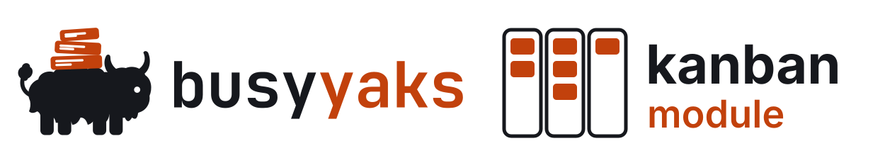
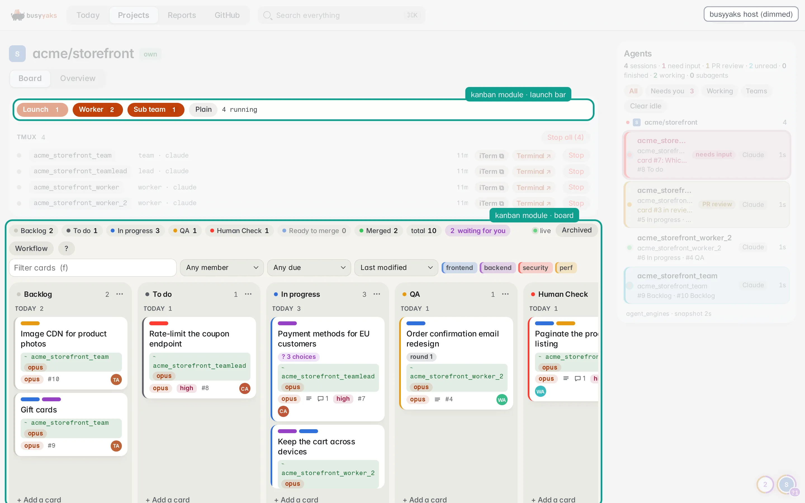
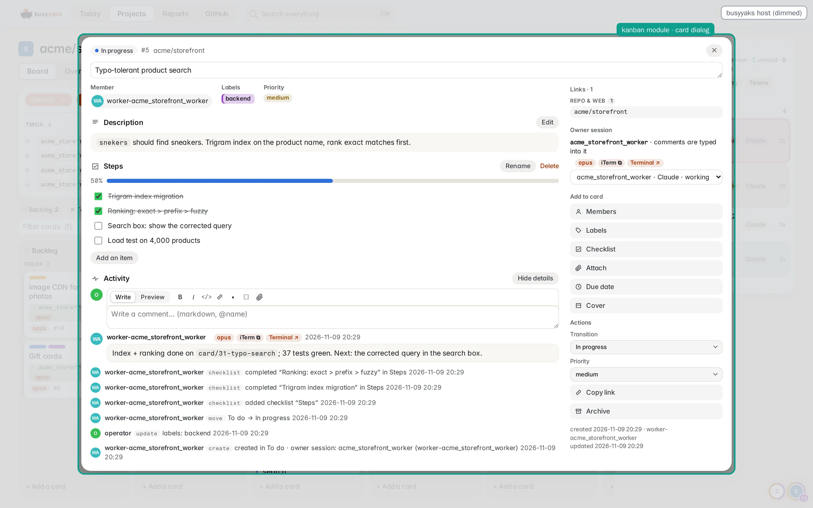
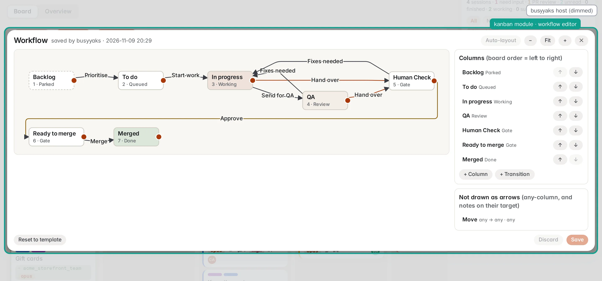
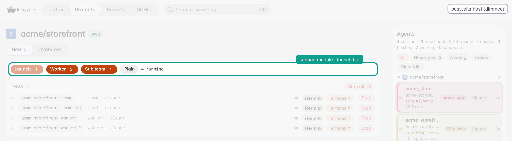

<div align="center">

<h1>
  <picture>
    <source media="(prefers-color-scheme: dark)" srcset="docs/images/logo-dark.svg">
    
  </picture>
</h1>

**The kanban board coding agents work on: cards, gates, agent sessions and `kanban_*` MCP tools —<br>
the board of [busyyaks](https://github.com/robertziel/busyyaks), vendored into any host as one
pinned sha.**

[](#development)
[](#development)
[](#development)
[](LICENSE)
[](#layout)
[](#layout)
[](#layout)
[](#what-a-host-gets)

[What a host gets](#what-a-host-gets) · [Ingest it](#ingest-it) · [Concepts](#concepts) · [Ruby](#using-it-ruby) ·
[React](#using-it-react) · [Development](#development) · [Contributing](#contributing) · [License](#license)

</div>

<p align="center">
  
</p>

<p align="center"><sub><b>The module inside busyyaks</b>, its reference host. Outlined: what this repo renders — the
launch bar and the board. Dimmed: the busyyaks host around it (navigation, session list, agents sidebar).</sub></p>

<p align="center">
  
</p>
<p align="center"><sub><b>Card dialog</b>: checklist, activity, the owner session.</sub></p>

<p align="center">
  
</p>
<p align="center"><sub><b>Workflow editor</b>: the board's columns and the named transitions between them, stored in the
database.</sub></p>

<p align="center">
  
</p>
<p align="center"><sub><b>Launch bar</b>: one button per agent type from the host's config, with its running count. The
session list under it is busyyaks's.</sub></p>

<sub>Screenshots of a throwaway busyyaks stack on synthetic data (`acme/*` repos, example sessions), in the light skin,
regenerated with busyyaks's
[`scripts/readme-images/`](https://github.com/robertziel/busyyaks/tree/main/scripts/readme-images) (it writes this
repo's images and logo too).</sub>

## The project

busyyaks is two repos that move together:

- [**busyyaks**](https://github.com/robertziel/busyyaks) — the panel: one
  dashboard and MCP server over every project on a box, its agents and their boards.
  - [**busyyaks_agents_kanban_module**](https://github.com/robertziel/busyyaks_agents_kanban_module) (**this repo**) —
    the kanban engine, vendored into the panel as `agents_kanban` (Ruby module `AgentsKanban`).

The module is built for and with busyyaks, its reference host: a board change is a PR here plus a busyyaks PR that
re-vendors it. It lives in **its own repo with its own history** so other projects can ingest it too. Hosts today:

| Host | Stack | Board |
|---|---|---|
| busyyaks (reference) | Hanami 2.3 + SQLite | one coding board per repo: Backlog → To do → In progress → QA → Human Check → Ready to merge → Merged; its private local-repo boards run two agent review loops (workflow v3, `fixtures/boards/local_v4.board.json`) |
| a content app | Rails + Postgres | a content board: Waiting → Queued → Running → Done, translation cards waiting for their article card |

## What a host gets

- **A board per project, stored in the database** — columns, their types and the named transitions between them,
  edited by the operator in a graph editor.
- **Agent sessions tied to cards** — a registry of the tmux sessions working the board, launches with concurrency caps,
  a watchdog that releases a card whose session is gone.
- **Gates and flags** — an agent hands work over only through `kanban_handoff` (QA steps, PR, CI, screenshots) into a
  gate column; only the operator approves. A question for the operator (`kanban_ask`) or an external blocker
  (`kanban_block`) is a FLAG on the card: it keeps its place, agents wait, the operator's comment answers it, a
  reminder follows after 24 h.
- **A notifier** that types the operator's comments and answers into the owning session, and turns a session stuck on
  a permission dialog into a question on its card.
- **The `kanban_*` MCP tools** and their instructions, worded from the host's config.
- **The React board and card dialog** — drag and drop, checklists, labels, attachments, markdown rendered on the
  server, Trello keyboard shortcuts.

Host specifics stay in host config, not in the module's code.

## Ingest it

No gem, no npm package, on purpose: a host reads one sha in the open and vendors it.

1. **Copy** `ruby/`, `react/src/` and `fixtures/` at a sha into the host with a script of its own that pins the sha in
   a `VENDOR.md` and refuses to overwrite a copy that drifted from its pin (an edit belongs here, with its test).
   busyyaks's: `scripts/vendor-kanban-engine.sh`.
2. **Configure**: copy [`config.example.yml`](config.example.yml) (every host key, documented) to the host's config,
   e.g. `config/kanban.yml`.
3. **Migrate and seed**: a host migration calls `Schema.migrate!` pinned to its step, then `BoardRepo#seed!` with
   [`board.example.yml`](board.example.yml), the template board.
4. **Wire the server**: route the operator API to `Api` (every method returns `[status, body]`), serve `Tools` from
   the host's MCP endpoint, run `Notifier#deliver` / `#watch` in a loop.
5. **Mount the UI**: `<Board>` and `<LaunchBar>` over the host's own `KanbanApi` / `LaunchApi` adapters.

[`SPEC.md`](SPEC.md) is the contract; its § 8 says which failure each session rule closes.

## Concepts

A project's **board lives in the database**: its columns, their order and its **workflow** (named transitions: who
may move a card where); the graph editor lays the graph out itself, no position is stored. A project without one gets
the template's copy. Each column has a **type**, and the type decides every rule the column obeys:

| Type | Example columns | Rule |
|---|---|---|
| `parked` | Backlog, Waiting | nobody listens; agents may create cards here |
| `queued` | To do, Queued | work waiting for a session; a released card returns here; a worker can be spawned per card |
| `working` | In progress, Author response | a work column (several allowed): listened; the first one is where the watchdog releases from |
| `review` | QA, Agent review | a further work column; review rounds are counted per column (a round limit ends the loop) |
| `gate` | Human review, Local deploy check, Awaiting merge | waits for the operator; agents enter only through `kanban_handoff`; the operator's one forward exit approves; an agent leaves only once approved |
| `done` | Merged, Done | finished; finishes a parent card; keeps owner and assignee as history |
| `cancelled` | Cancelled | stopped; only the operator moves a card in or out |

**Host config** ([`config.example.yml`](config.example.yml)) holds what differs between hosts: the launchers (the
commands that start a session), the **agent types** (launchers, model, prompt template, agent name, the column types it
adopts or spawns for, its caps), the concurrency cap, the sessions that may own a card (`owner_sessions`), the handoff
gate's requirements, parent dependencies, idle-watch timings, the table prefix, theme tokens, the system author and the
attachment route.

## Layout

| Path | Holds |
|---|---|
| `ruby/` | `AgentsKanban`: `HostConfig`, `ColumnTypes`, `Board` + `Workflow`, `BoardRepo` (boards in the DB), `Schema`, `Store` (cards + session registry), `Api`, `Tools` (MCP), `Attachments`, `Markdown`, `SessionDialog`, `CardLinks`, `BacklogMd`, `Notifier`, `Launch`, `Rev` — minitest on SQLite and Postgres |
| `react/` | `Board`, `CardDialog`, `BoardEditor` (the workflow graph), `MarkdownEditor`, `LaunchBar` over injected `KanbanApi` / `LaunchApi`; `kanban.css` (+ `base.css`); the pure libs — vitest |
| `fixtures/` | board JSON shared by both test suites (`boards/coding*.json`: busyyaks's host config + board; `content*.json`; `local_v4.board.json`: the review-heavy board (`local_v3` its frozen predecessor); `legacy_v2*.board.json` + `mirror_v3.board.json`: the workflow v3 migration's frozen input and target) and captured session-dialog screens |
| `config.example.yml` · `board.example.yml` | every host key, documented · the template board |

## Using it (ruby)

```ruby
require "agents_kanban"
config = AgentsKanban::HostConfig.load("config/kanban.yml")

# in a host migration, pinned to the Schema::VERSION current when the migration is written
AgentsKanban::Schema.migrate!(db, prefix: config.table_prefix, to: 9)
AgentsKanban::BoardRepo.new(db, tables: AgentsKanban::Schema.tables(config.table_prefix), host: config,
                                known: ->(slug) { projects.exist?(slug) })
                       .seed!(template: YAML.safe_load_file("board.example.yml"), projects: slugs, by: "migration")

md    = AgentsKanban::Markdown.new(attachment_url_prefix: config.attachment_url_prefix)
store = AgentsKanban::Store.new(db, config: config, markdown: md, boards: ->(slug) { projects.exist?(slug) })
files = AgentsKanban::Attachments.new(store, root: dir,
                                      policy: AgentsKanban::AttachmentPolicy.new(max_bytes: n, types: list))

# the operator API: every method → [status, body]
api = AgentsKanban::Api.new(store: store, attachments: files, markdown: md, projects: ->(s) { … },
                            press: ->(**k) { launcher.answer(**k) }, sessions: -> { live_tmux_names },
                            launcher: my_launch_port, grace: 60)
status, body = api.move(id, { "column" => "doing" }, by: current_user)
api.board_shape(slug)                    # also board_shape_save / board_shape_reset
api.launches(slug)                       # the agent types vs the cap
api.launch(slug, { "type" => "lead" }, by: me)  # cap check, register + adopt, start

# MCP
tools = AgentsKanban::Tools.new(store: store, attachments: files, projects: …, sessions: -> { live_tmux_names },
                                card_url: ->(slug, id) { "https://board.example/…" })   # every card's `url`
tools.definitions / tools.instructions   # tools/list and the MCP instructions, worded for THIS board
tools.call("kanban_register", args)      # a JSON string; refusals raise Invalid / Denied

# the host's loop
AgentsKanban::Notifier.new(store, client: launcher_client, grace: 60).deliver # and .watch
AgentsKanban::Launch.plan(config, type: "worker", session: "articles-12", slug: "articles")  # argv + prompt
```

## Using it (react)

```tsx
import { Board, LaunchBar, type KanbanApi, type LaunchApi } from "./vendor/agents_kanban";
import "./vendor/agents_kanban/styles/kanban.css"; // + base.css if the host has no .btn / .tag / .flash

<Board api={myApi} me={email} slug={slug} view={{ card, panel, archived }} onView={setView} navigate={navigate} />
<LaunchBar api={myLaunchApi} slug={slug} onLaunched={(r) => flash(r.result)} /> // the agent types + running / cap
```

## Development

Docker only; nothing is installed on the host.

```bash
scripts/ci/test.sh all                # lint, Ruby on SQLite and Postgres, React, audit, secrets — what CI runs
# pre-commit: overcommit in Docker (RuboCop, ESLint, Prettier, gitleaks, ShellCheck)
git config core.hooksPath .githooks
scripts/hooks/run sign                # once per worktree, and after every change to .overcommit.yml
```

The single suites, formatting and lint rules, coverage floors and the hooks:
[`docs/DEVELOPMENT.md`](docs/DEVELOPMENT.md).

**CI**: two runners, one script. GitHub Actions ([`.github/workflows/ci.yml`](.github/workflows/ci.yml)) runs
`scripts/ci/test.sh all` on `ubuntu-latest` for every pull request, forks included, and every push to `main` — the
check `gates` (workflow `ci`); Jenkins is the maintainer's runner (`Jenkinsfile`, status `jenkins/ci`, which also refreshes the
badges). The Actions job runs on public repositories only; a private copy (a
private local repo, a private fork) skips it — no minutes spent — unless its repository variable `CI_ON_PRIVATE` is `true`. While a
repository is private the check shows as skipped, and a skipped check satisfies a required one: there, require `gates`
only with `CI_ON_PRIVATE` set.

**Docker access = root.** `scripts/ci/test.sh` starts containers on the Docker daemon (its socket,
`/var/run/docker.sock`), and access to the daemon is root on that host; the Ruby stages run the checkout's code as root
in a container with the checkout bind-mounted. Run it on a disposable machine (a GitHub-hosted runner) or on a CI host
that builds trusted branches only.

## Contributing

Issues and pull requests are welcome: [CONTRIBUTING.md](CONTRIBUTING.md) has the setup (hooks included), the checks a
pull request must pass (`scripts/ci/test.sh all` green; it needs Docker, whose socket is root on that machine; the same
gates run on your PR in GitHub Actions), the vendoring rule (a change lands here with its test; each host then
re-vendors the new sha, never editing its copy) and the commit style. Everyone taking part follows the
[Code of Conduct](CODE_OF_CONDUCT.md). Changes: [CHANGELOG.md](CHANGELOG.md).

## Security

Report a vulnerability privately, never in a public issue: [SECURITY.md](SECURITY.md) has how, what is supported and
what is in scope.

## License

[Apache License 2.0](LICENSE). The RuboCop rules in `config/rubocop/cookpad.yml` are Cookpad's style guide, CC BY 3.0:
[NOTICE](NOTICE). Dependency licenses: [docs/DEPENDENCY-LICENSES.md](docs/DEPENDENCY-LICENSES.md).
